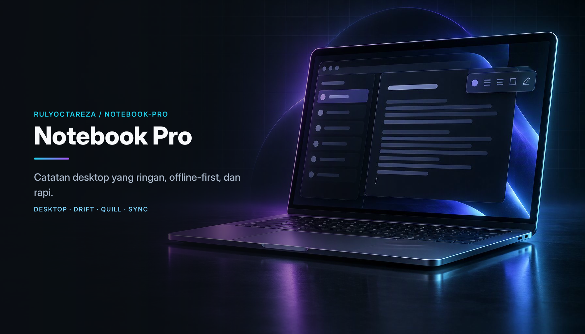

<p align="center">
  
</p>

<h1 align="center">Notebook Pro</h1>

<p align="center">
  <b>Catatan desktop yang ringan, offline-first, dan rapi.</b><br>
  macOS · Windows · Linux — terinspirasi Apple Notes.
</p>

<p align="center">
  <a href="https://flutter.dev"></a>
  <a href="https://riverpod.dev"></a>
  <a href="https://drift.simonbinder.eu"></a>
  <a href="https://firebase.google.com"></a>
</p>

---

## ✨ Preview

<p align="center">
  
</p>

> **Catatan:** gambar di atas adalah *ilustrasi konsep*, bukan screenshot asli.

---

## 📖 Tentang

Notebook Pro adalah notepad desktop dua panel: daftar catatan di kiri, editor rich text di kanan.
Semua ditulis ke SQLite lokal lewat Drift, jadi tetap instan tanpa internet. Kalau kamu login
dengan Google, catatan disinkronkan ke Firestore di bawah `users/{uid}/…` dengan penanganan
konflik *last-write-wins*.

---

## 🌟 Fitur

- Panel ganda: daftar catatan + editor rich text (Quill)
- Folder, tag, pin section, Trash / restore
- Judul, heading, bold/italic, tautan, gambar, find-in-note
- Import Markdown, export PDF / MD / TXT, dan print
- SQLite offline (Drift) + sinkronisasi Firebase saat login
- Indikator status sync dan penanganan konflik last-write-wins
- Daily writing streak, target kata mingguan, dan achievement badge
- Focus mode, command palette, settings, backup JSON lokal
- Tema Light / Dark / System

---

## 🛠️ Tech Stack

| Area | Pilihan |
|---|---|
| Framework | Flutter desktop (macOS, Windows, Linux) |
| State management | Riverpod + Freezed |
| Database | Drift (SQLite) |
| Editor | `flutter_quill` |
| Sync | Firebase (Firestore + Auth) |
| Routing | GoRouter |

---

## 🚀 Menjalankan

```bash
flutter pub get
dart run build_runner build --delete-conflicting-outputs
flutter run -d macos
```

Ganti `-d macos` dengan `-d windows` atau `-d linux` sesuai platform.

---

## 🧪 Testing

```bash
flutter analyze
flutter test
```

---

## 🏗️ Arsitektur

Clean Architecture dengan folder per fitur (`notes`, `gamification`, `settings`).
Data lokal lewat Drift; `FirebaseSyncService` (atau `NoopSyncService` saat offline)
menyinkronkan ke `users/{uid}/…` setelah sign-in Google.

<p align="center">Ditulis untuk orang yang percaya catatan terbaik adalah catatan yang selalu bisa dibuka.</p>
